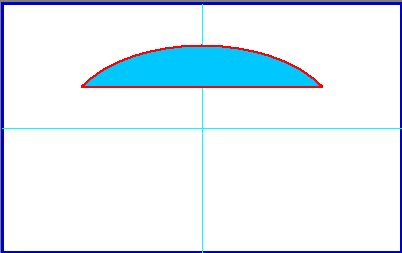
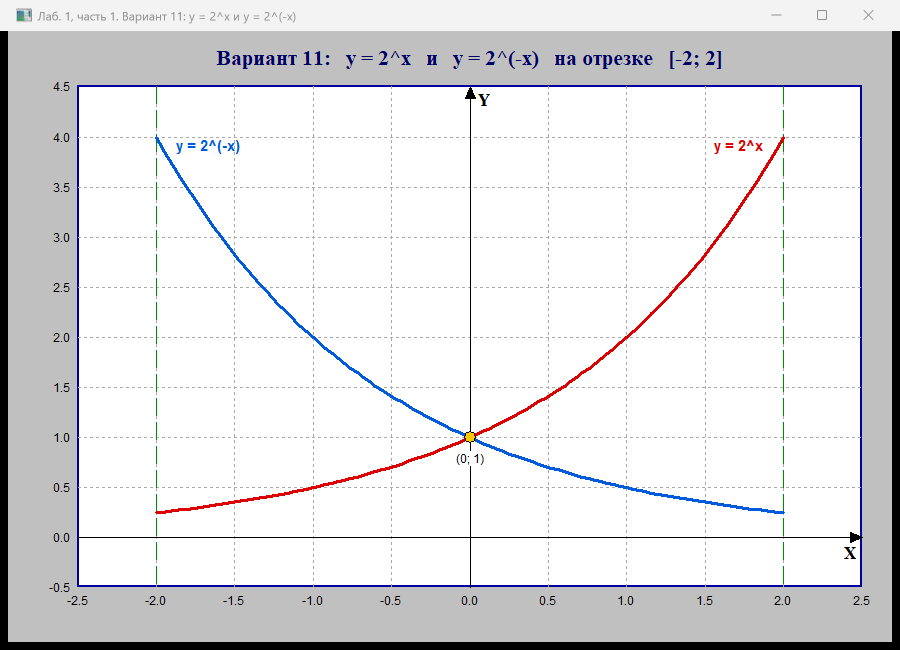
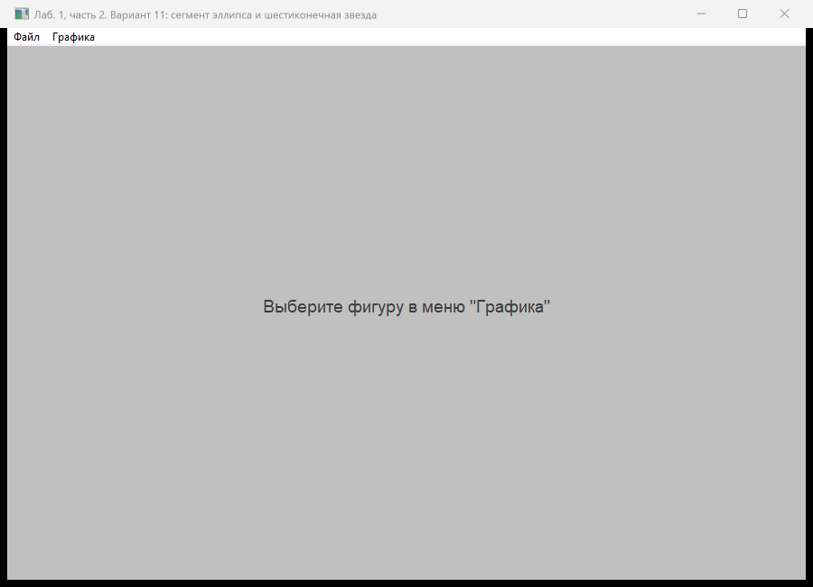
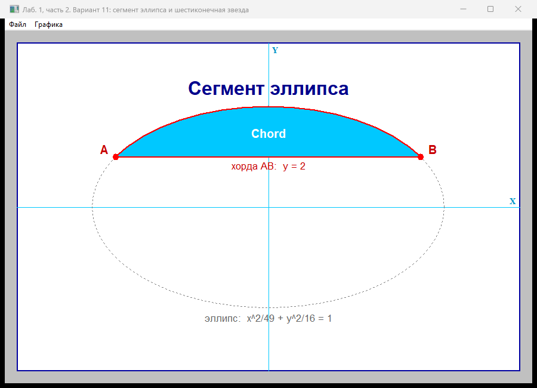
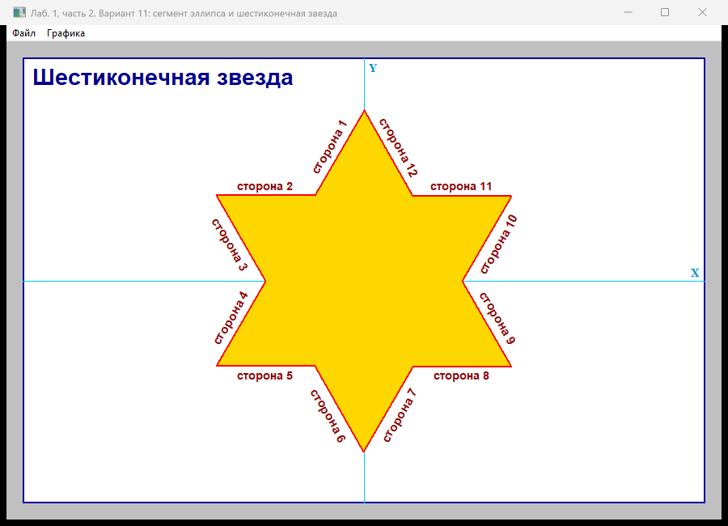

# Лабораторная работа №1. Интерактивные графические системы

Тема: создание программ построения графиков с помощью графических примитивов API Windows, создание меню для отображения графических объектов.

Вариант 11.

**Задание:**

1. Нарисовать в одних осях графики функций y = 2^x и y = 2^(-x) на интервале [-2; 2].
2. Написать программу с меню, которая выводит два объекта: сегмент эллипса и полигон в виде шестиконечной звезды. На объектах должны быть надписи, у звезды надпись должна быть у каждой стороны.

Объект 1 из методички:



## Результат

Часть 1 (Graphs.exe):



Часть 2 (MenuWin.exe). После запуска окно пустое, фигура выбирается в меню "Графика":



Графика -> Сегмент эллипса:



Графика -> Шестиконечная звезда:



## Файлы

- `Part1_Graphs/Graphs.cpp` - часть 1
- `Part2_Menu/MenuWin.cpp` - часть 2
- `Part2_Menu/MenuWin.rc` - меню
- `Part2_Menu/resource.h` - идентификаторы пунктов меню
- `images/` - скриншоты
- `CMakeLists.txt`, `build_mingw.bat` - сборка

## Сборка

В Visual Studio 2019/2022: Файл -> Открыть -> Папку, выбрать `Lab01`, проект подхватится из `CMakeLists.txt`. Дальше выбрать Graphs.exe или MenuWin.exe и запустить.

Можно собрать и как в методичке: пустой проект Win32, добавить в него .cpp (для второй части ещё MenuWin.rc и resource.h) и в свойствах проекта поставить Character Set = Unicode.

Я собирал через MinGW:

```
build_mingw.bat
```

Готовые exe появляются в папке `bin`.

## Часть 1

За основу я взял пример GraphWin из методички.

Функции варианта:

```cpp
double f1(double x) { return pow(2.0, x); }
double f2(double x) { return pow(2.0, -x); }
const double A = -2.0, B = 2.0;
```

На [-2; 2] обе функции принимают значения от 0.25 до 4, поэтому мировое окно я взял с запасом:

```cpp
xLeft = -2.5; xRight = 2.5; yBottom = -0.5; yTop = 4.5;
```

Поле вывода в пикселях считается от размеров клиентской области (GetClientRect), поэтому график растягивается вместе с окном. Чтобы при изменении размера окно перерисовывалось целиком, в стиле класса окна стоит `CS_HREDRAW | CS_VREDRAW`.

Перевод из мировых координат в экранные делается функциями xn() и ym(), как в методичке:

```
n = (x - xLeft)   / (xRight - xLeft)  * (nRight - nLeft) + nLeft
m = (y - yBottom) / (yTop   - yBottom) * (mTop  - mBottom) + mBottom
```

Рисование идёт в обработчике WM_PAINT (функция Graph_OnPaint): поле с рамкой, сетка с шагом 0.5, границы интервала пунктиром, оси со стрелками (стрелки нарисованы через Polygon), числа на осях.

Сами графики строятся по 101 точке. Точки сразу переводятся в пиксели и рисуются ломаной Polyline:

```cpp
for (int i = 0; i < N; i++)
{
    double x = A + dx * i;
    P1[i].x = xn(x);  P1[i].y = ym(f1(x));
    P2[i].x = xn(x);  P2[i].y = ym(f2(x));
}
SelectObject(hdc, hpenF1);  Polyline(hdc, P1, N);
SelectObject(hdc, hpenF2);  Polyline(hdc, P2, N);
```

Графики пересекаются там, где 2^x = 2^(-x), то есть в точке (0; 1). Я отметил её кружком. Графики симметричны относительно оси Y, так удобно проверить, что построение правильное.

В конце, как написано в методичке, в контекст возвращаются старые перо, кисть и шрифт, созданные объекты удаляются через DeleteObject, затем вызывается EndPaint.

## Часть 2

За основу я взял пример MenuWin из методички.

Меню описано в MenuWin.rc: "Файл - Выход" и "Графика - Сегмент эллипса / Шестиконечная звезда / Очистить". Чтобы русские названия пунктов не превратились в кракозябры, в начале .rc стоит `#pragma code_page(65001)`. Меню подключается в WinMain:

```cpp
wc.lpszMenuName = MAKEINTRESOURCE(IDR_MENU1);
```

Пункты меню обрабатываются в WM_COMMAND. В примере из методички фигура рисовалась сразу через GetDC, и, как там же сказано, картинки накладывались друг на друга. Ещё при таком способе рисунок пропадает, если свернуть окно. Поэтому я сделал так: при выборе пункта меню номер фигуры сохраняется в g_figure и вызывается InvalidateRect, а рисует уже WM_PAINT. Это тот же приём, что в методичке используется для пункта Clean.

```cpp
case ID_CHORD:  SelectFigure(hWnd, FIG_CHORD);  break;
case ID_STAR:   SelectFigure(hWnd, FIG_STAR);   break;
case ID_CLEAN:  SelectFigure(hWnd, FIG_NONE);   break;
```

Масштаб по X и Y я сделал одинаковым (функция SetupField), иначе в широком окне звезда и эллипс сплющиваются. Поле вывода заливается белым и задаётся как область отсечения через SelectClipRgn, как в примере Ellipse_OnDC.

### Сегмент эллипса

Для сегмента в GDI есть функция Chord. Я взял эллипс с центром в (0; 0) и полуосями a = 7, b = 4 и отсёк его хордой y = 2. Концы хорды нашёл из уравнения эллипса:

x = a * sqrt(1 - (y/b)^2) = 7 * sqrt(1 - 1/4) = 6.06

Получились точки A(-6.06; 2) и B(6.06; 2).

Chord рисует дугу против часовой стрелки от первой точки ко второй. Чтобы получилась верхняя часть, как на рисунке в задании, первой передаётся B, второй A:

```cpp
Chord(hdc, xn(-a), ym(b), xn(a), ym(-b),
           xn(xc), ym(yc), xn(-xc), ym(yc));
```

Весь эллипс я дорисовал пунктиром, чтобы было видно, откуда взят сегмент. Подписал заголовок, точки A и B, хорду и уравнение эллипса.

### Шестиконечная звезда

Звезда рисуется функцией Polygon по 12 вершинам. Чётные вершины, концы лучей, лежат на окружности радиуса R = 5. Нечётные, впадины, лежат на окружности радиуса r. Шаг между вершинами 30 градусов.

```cpp
double angle  = PI / 2 + i * PI / 6;
double radius = (i % 2 == 0) ? R : r;
Vt[i].x = radius * cos(angle);
Vt[i].y = radius * sin(angle);
```

Радиус r = R / sqrt(3) нужен, чтобы звезда получилась правильной, то есть из двух равносторонних треугольников. Сторона такого треугольника находится на расстоянии R/2 от центра, а впадина повёрнута на 30 градусов относительно этого перпендикуляра. Поэтому r = (R/2) / cos(30) = R / sqrt(3).

Надписи "сторона 1" ... "сторона 12" выводятся у каждой стороны, параллельно ей. Угол наклона стороны я считаю через atan2 по экранным координатам её концов. В методичке для этого был коэффициент masht, а у меня масштаб по осям одинаковый, поэтому можно сразу брать пиксели. Угол задаётся шрифту через lfEscapement в десятых долях градуса.

Чтобы надписи на нижних сторонах не были вверх ногами, угол приводится к диапазону от -90 до 90 градусов. Чтобы надпись была снаружи звезды, по внешней нормали к стороне выбирается выравнивание: TA_BOTTOM или TA_TOP.

В примере Polygon_OnDC шрифты в цикле создаются, а удаляется только последний. У меня каждый шрифт удаляется сразу после вывода надписи.
